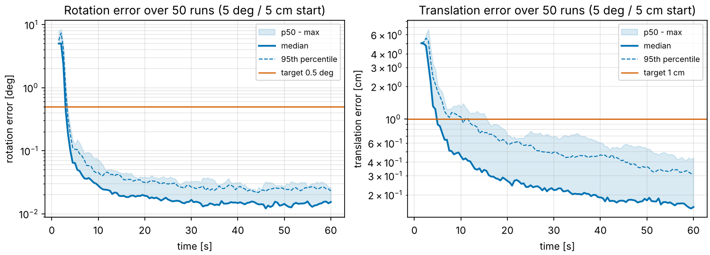
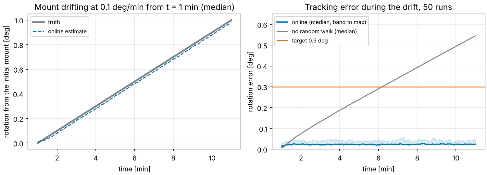

# AutoCal-lite

**Targetless, online stereo/IMU extrinsic calibration that recovers a rig from a 5° / 5 cm
miscalibration in seconds and keeps tracking the mount as it drifts.** It is an error-state EKF
in C++17, built on the estimation, sensor-model and Monte-Carlo core of
[Aether6](https://github.com/Nathan-W123/Aether6). It uses no calibration target, no operator
and no ground truth, only the sensor data.



## Results

50 Monte-Carlo runs per scenario, with deterministic seeds (`make eval` reproduces every
number below). Each run draws its own landmark field, truth mount (nominal ± 2° / ± 2 cm),
IMU biases, noise, and the *direction* of the 5° / 5 cm error in the starting estimate.

| criterion | target | result |
|---|---|---|
| **1. Converge** from 5° rotation / 5 cm translation error | < 0.5° and < 1 cm within 60 s in ≥ 95 % of 50 runs | **50 / 50 runs (100 %)**. Error at 60 s, p95: **0.023° / 0.32 cm** (worst run 0.026° / 0.44 cm). Median time to converge 5.8 s (p95 11.6 s) |
| **2. Track drift**: after convergence the true mount rotates at 0.1°/min for 10 min (1° total) | tracking error < 0.3° | **50 / 50 runs**. Worst tracking error over the 10 min: **0.060°** (p95 0.056°, RMS 0.024°). The same filter without the extrinsic random walk falls behind: 0.55° after 10 min and still diverging (0 / 50 pass) |



Supplementary scenarios (same 50 seeds):

| scenario | what changes | result |
|---|---|---|
| `time_offset` | camera clock 8 ms off the IMU clock, estimated online | 50 / 50 converge; t_d recovered to 0.03 ms (p50), 0.07 ms (p95) |
| `outliers` | 5 % of the correspondences are wrong | 50 / 50 converge (p95 0.026° / 0.31 cm); the per-landmark χ² gate removes them |
| `knock` | the mount is knocked by 1.5° / 2 cm at t = 90 s | the change detector fires once in every run; back under 0.5° and 1 cm after 3.4 s (p50) / 8.7 s (p95); 0.012° / 0.15 cm at 180 s |
| `knock_no_detector` | same knock, detector off | the random walk recovers the rotation but not the lever arm: 1.05 cm still off at 180 s (7 / 50 back under 1 cm) |
| `yaw_only` | roll and pitch excitation removed | 6 / 50 converge: the lever arm along the yaw axis is unobservable (2.4 cm p50 error), exactly as the theory predicts |
| false alarms | change detector on every run above without a knock | **0 in 250 runs** (≈ 12 h of simulated data) |

The extrinsic covariance is reported alongside every estimate. The vision NIS is 1.00 per
degree of freedom, so the noise model matches the data, and the extrinsic NEES is 2.0
(6 = consistent): the filter is **conservative** by about 1.4× in σ, for a known reason
([docs/method.md §8](docs/method.md#8-consistency-honestly)). A 60 s run takes 0.95 s of
wall-clock time on one core.

## The problem

A stereo camera and an IMU are bolted to the same rig. Fusing them needs the rigid transform
between them: the extrinsic, 3 rotation + 3 translation parameters. Today that transform is
measured once with a checkerboard and an expert, and measured again whenever the hardware
shifts: a knock, thermal cycling, a re-mount. AutoCal-lite estimates it **continuously from
normal operation**:

* **Input.** 200 Hz IMU samples and 20 Hz stereo frames with feature correspondences (the
  front end is out of scope; correspondences are provided, 0.5 px noise). Known intrinsics and
  a 12 cm baseline. A nominal "CAD" extrinsic that is wrong by 5° and 5 cm.
* **Not input.** Landmark positions (there is no target), the trajectory, the true extrinsic,
  or any other ground truth. The estimator initialises itself from a 1.5 s stationary IMU
  window.
* **Output.** The extrinsic with a covariance, the IMU biases, and optionally the camera-IMU
  time offset, updated at every frame.

## How it works

```
 IMU 200 Hz ──► trapezoidal propagation of pose/velocity/biases (Aether6 error dynamics)
                          │
 stereo 20 Hz ─► landmarks seen in the previous AND current frame
                 ├─ triangulate (stereo) + 3 Gauss-Newton steps over the 4 views
                 ├─ 8 reprojection residuals per landmark, predicted with the CURRENT
                 │  extrinsic estimate; analytic Jacobians
                 ├─ landmark marginalised exactly (left null space, 5 residuals remain)
                 ├─ chi-square gate per landmark (wrong correspondences)
                 └─ QR-compress ~500 rows to 28 ─► Aether6 Joseph-form update
                          │
            stochastic clone moves to the current pose; change detector watches the
            extrinsic corrections and re-opens its covariance after a knock
```

* **Small state, no landmarks.** 28 error states: IMU pose/velocity (9), biases (6),
  extrinsic (6), time offset (1), and one stochastic clone of the previous frame's pose (6).
  The landmarks are marginalised per update, so there is no map and no sliding window.
* **Never recalibrate.** The extrinsic is a random walk. Its intensity was chosen by a sweep
  so that a drifting mount is followed with a lag far inside the requirement, while the
  covariance stays consistent with the drift. A change detector catches knocks.
* **Observability.** The figure-eight trajectory carries roll, pitch *and* yaw excitation.
  With rotation about a single axis, the lever-arm component along that axis is
  unobservable (the `yaw_only` row above shows this).

The full derivation (Jacobians, null-space marginalisation, observability, the drift/knock
logic, and a candid consistency analysis) is in [docs/method.md](docs/method.md).

## Built on Aether6

The tree mirrors [Aether6](https://github.com/Nathan-W123/Aether6)'s layout (`include/aether/…`,
`src/…`, `apps/`, `tests/`, same CMake/Makefile/CI and namespaces), so the module is laid out
to be merged back. Going into the Aether6 tree means adding `calib/`, the two small extracted
core pieces (`estimation/EskfCore`, `sensors/Imu`) and the generic `mc::runCampaign` next to
Aether6's existing files, plus the `Vec2` alias in `core/Types.hpp`. Files taken from Aether6
(MIT, commit `6b8dc56`) say so in their header.

| | what | where |
|---|---|---|
| **Reused** | Quaternion/rotation algebra, Van Loan discretisation, matrix exponential | `math/Rotation.hpp`, `math/LinearAlgebra.*` (verbatim; LQR/Riccati dropped) |
| **Reused** | Central-difference Jacobians (used by the Jacobian tests) | `math/NumericalDiff.hpp` (verbatim) |
| **Reused** | SplitMix64 seed derivation, deterministic RNG, CSV writer | `util/Random.hpp`, `util/Csv.*` (verbatim) |
| **Reused** | IMU white noise + initial bias + bias random walk, same RNG stream | `sensors/Imu.*` (Aether6 `SensorSuite` IMU branch, lifted out) |
| **Reused** | ESKF numerics: series/Van Loan discretisation, gated Joseph-form update, multiplicative attitude reset | `estimation/EskfCore.*` (extracted from Aether6 `ErrorStateEkf`) |
| **Reused** | Deterministic multi-threaded Monte Carlo and its statistics | `mc/MonteCarlo.*` (thread pool + seed scheme generalised to a template; `computeStatistics` verbatim) |
| **Reused** | Build system and CI (system-or-fetched Eigen/Catch2, strict warnings, `-Werror` CI on GCC/Clang/Debug) | `CMakeLists.txt`, `Makefile`, `.github/workflows/ci.yml` |
| **Adapted** | Error-state EKF: Aether6's 18-state nav filter becomes a 28-state calibrator (extrinsic + time offset + clone; wind/baro states removed) | `calib/ExtrinsicCalibrator.*` |
| **Replaced** | Flight dynamics replaced by a scripted figure-eight with roll/pitch/yaw excitation and analytic derivatives | `calib/Trajectory.*` |
| **New** | Stereo camera + landmark scene + truth mount with drift/knock; reprojection model; trial scoring and scenarios | `calib/StereoCamera.*`, `calib/CalibSimulator.*`, `calib/MeasurementModel.*`, `calib/Campaign.*` |

## Reproduce

Prerequisites: a C++17 compiler (tested with GCC 13), CMake ≥ 3.16, and Python 3.9+
(standard library only; Matplotlib optional, for the figures). Eigen 3 and Catch2 v3 are
taken from the system when present and **fetched automatically otherwise**. There is no ROS
dependency.

```bash
make build      # configure + compile (Release)
make test       # Catch2 suite
make run        # one 60 s convergence run: prints its scores, writes results/runs/
make eval       # 50-run campaigns for every scenario, then prints the convergence table,
                # the drift-tracking table and plot data, and renders results/figures/
```

`python3 python/scripts/eval.py --skip-run` re-prints the tables from the committed
`results/mc/` without re-running anything. The apps take `--help`. Any parameter can be
swept from the command line, for example:

```bash
./build/bin/autocal_run --scenario drift --set rot_walk=5e-5
./build/bin/autocal_mc  --scenario convergence --trials 50 --set pixel_noise=1.0 --set pixel_sigma=1.0
```

Scenarios: `convergence`, `drift`, `drift_frozen`, `knock`, `knock_no_detector`,
`time_offset`, `yaw_only`, `outliers`.

## Layout

```
include/aether/calib/   the calibration module (new)       src/calib/      its sources
include/aether/{core,math,util,sensors,estimation,mc}/      reused Aether6 core
apps/autocal_run.cpp    one trial -> scores + time series
apps/autocal_mc.cpp     deterministic Monte-Carlo campaigns -> trials.csv, envelope.csv, summary.json
python/scripts/eval.py  criteria tables, drift-tracking plot data, figures
tests/                  Catch2 suite (Jacobians vs. numerical, simulator truth, filter regressions)
docs/method.md          derivation and design notes
results/                committed campaign outputs and figures
```

## What this demonstrates for AutoCal

AutoCal's hard problem is an extrinsic calibration that stays right without targets or
experts. This prototype runs that whole loop end to end and measures it. The scene itself is
the target: landmarks are triangulated and marginalised on the fly and never surveyed. The
rig initialises itself from 1.5 s of stillness and pulls a CAD-level 5° / 5 cm error down to
0.02° / 3 mm in every one of 50 randomised runs, typically within 6 s. Because the extrinsic is
modelled as a slowly varying state with a covariance, not a constant measured once, the
same filter holds a mount that drifts 1° in 10 minutes to within 0.06°, where a filter that
treats the mount as fixed ends 0.55° off and keeps diverging. When the hardware is knocked, a
χ² test on the filter's own corrections notices within a few hundred milliseconds, and the
calibration re-converges in seconds with no operator. That is the "never recalibrate again"
behaviour, in miniature. What makes it trustworthy rather than a demo is what AutoCal needs
at scale: analytic Jacobians checked against numerical ones, a noise-free regression test
that catches simulator/estimator timing mismatches, consistency statistics reported next to
accuracy, zero false change alarms across 250 runs, and an observability ablation that shows
which motions the calibration needs. Growing it toward AutoCal means adding states and
sensors (intrinsics, more cameras, LiDAR), not changing the approach.

## Scope and limitations

This is a prototype on simulated data, not a product. The camera is an ideal rectified
pinhole pair: no lens distortion, no rolling shutter, known intrinsics. Correspondences are
given rather than detected. Only stereo + IMU is calibrated. The motion is a deliberately
exciting figure-eight. The filter's covariance is conservative by roughly 1.5× in σ
([docs/method.md §8](docs/method.md#8-consistency-honestly) explains why and what it would
cost to remove). The natural next steps toward AutoCal are camera intrinsics in the state,
real data with a feature front end, more sensor pairs (LiDAR-camera, multi-camera), and an
excitation monitor that tells the operator when the motion is not informative enough.
